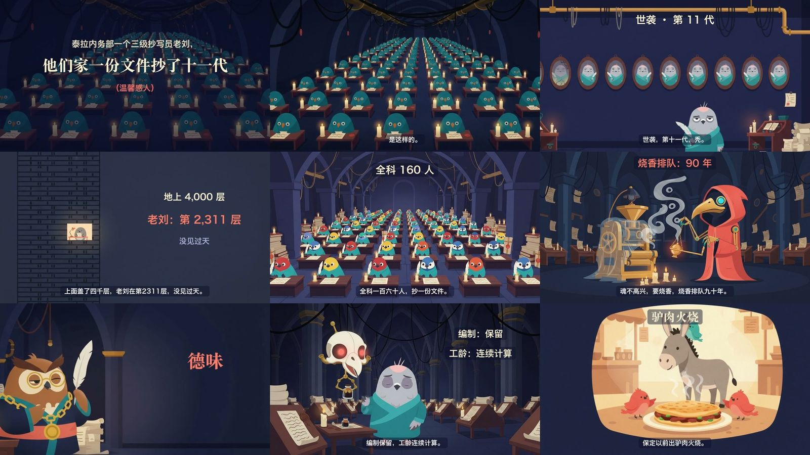
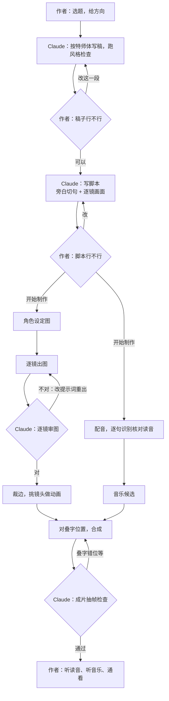
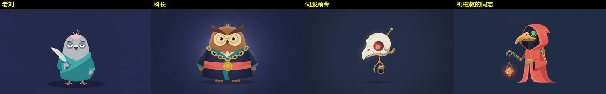
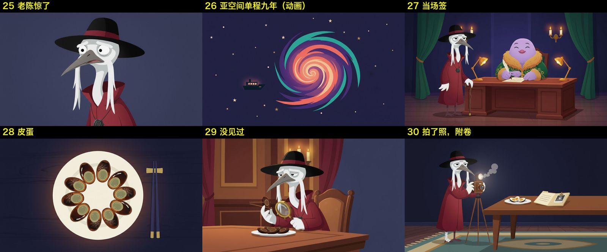
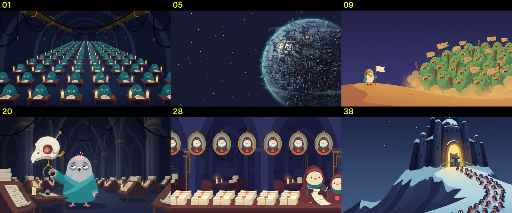
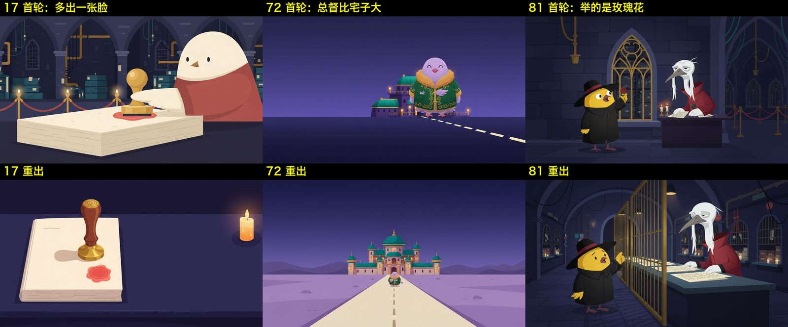
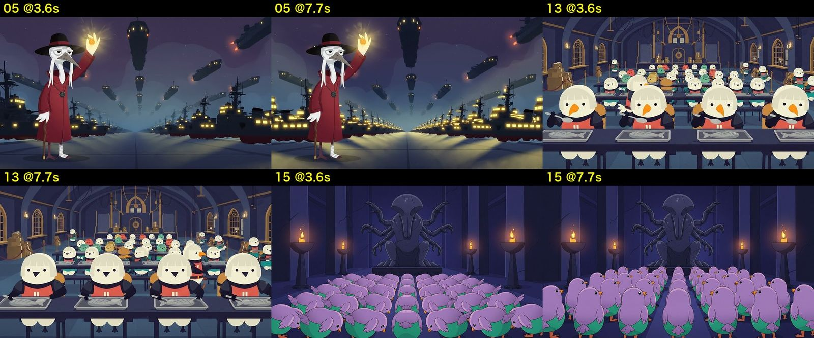
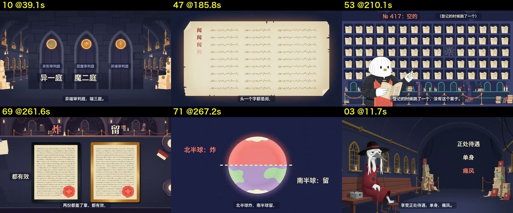

# 特师体小鸟短剧是怎么做出来的：以两部战锤 40K 为例

一篇一千字上下的稿子，从定稿到一部三到五分钟的带旁白短片，当天就能做完。作者写稿、拍板；Claude（跑在 Claude Code 里的 AI 助手）写脚本、调模型、审图、合成。这份文档用同一天（2026-11-23）做的两部战锤 40K 同人短片，说明每一步是怎么做的。

| 片子 | 讲什么 | 成片 |
| --- | --- | --- |
| 《他们家一份文件抄了十一代（温馨感人）》，下称《抄写员》 | 泰拉内务部的三级抄写员老刘，全科一百六十人手抄一份三千年前的增援申请；隔壁科抄的是同一颗星球的灭绝令。 | 3 分 26 秒 |
| 《材料交了四十年（励志向上）》，下称《审判庭》 | 审判官老陈想炸一颗星球，立案窗口说材料不齐，三个庭来回转，最后被拉进去顶一个记错的空号。 | 5 分 02 秒 |

两部都是 1920×1080，全程旁白加字幕。画面是平面矢量风格的小鸟，大部分镜头是静帧加缓慢推拉，每六到八镜插一段 8 秒的动画。成片和音频太大，没有放进这个仓库；仓库里是稿子、脚本、工具和制作记录。



## 流程总览

每一步做完都停下来等作者过目，再进下一步。前两步改起来不花钱，后面每一步都要调付费模型，所以把会返工的决定尽量放在前面。



| 步骤 | 谁做 | 谁拍板 | 产物 |
| --- | --- | --- | --- |
| 写稿 | Claude 起草，作者改 | 作者 | `teshi-style/samples/NN-名.md` |
| 脚本 | Claude | 作者 | `出脚本.py` → `脚本.md`、`分镜.json`、`配音/配音.json` |
| 配音 | Claude | 作者（听） | 逐句 mp3、时间轴、字幕 |
| 画面 | Claude | Claude 审图，作者看成片 | 角色设定图、每镜一张图 |
| 动画 | Claude | 同上 | 每段 8 秒的 mp4 |
| 音乐 | Claude 出候选 | 作者（听） | 两个候选 |
| 叠字与合成 | Claude | 作者 | 成片 mp4、`制作说明.md` |

## 第一步 写稿

"特师体"指的是模仿网络作者大咕咕咕鸡（张大锤）的文风：公文腔、器材评测腔和市井方言混在一起，一本正经地讲一个中年失败者的日常，笑点靠错位，结尾急停，底下压着一层惨。

写稿用的是一套事先整理好的写作规范，外加一个风格检查脚本。规范里最管用的几条：

- 叙述者必须是输家，赢了也得是误会。
- 至少一个精确到荒谬的数字、一个价签、一个具体食物、一个地名。
- 分句六到九个字，没有从句；一段六十字以上的逗号长流之后，甩一个三五个字的短句。
- 必须有一句不搞笑、直接惨的话，后面立刻接一个掉价的东西。
- 最后一句不给意义，不点题。

检查脚本只能查机械问题（句长、连接词、指纹词密度）。两篇稿子的机检都是满分，但满分只说明没有机械毛病，好不好笑要人看。

**作者改稿的例子。**《审判庭》初稿里，三个庭推管辖那一段是这样的：

> 材料齐了，三个庭讨论归谁。端三庭讲拜像属于异端。异一庭讲四只手属于异形。魔二庭讲再看看，万一呢。一月份三个庭抢，十一月份三个庭推，老陈是六月交的，没人理，放了六年。

作者的意见：踢皮球从来都是办事的人受气，让老陈在三个庭之间来回跑，文件上全是批示"阅"，交通费不报销；最后老陈崩溃了坐地上哭，正好端三庭记错了号，拉他进去凑数。改完是这样：

> 端三庭讲四只手属于异形，转异一庭。异一庭在第三千层，电梯一趟四十分钟，四王座币。异一庭讲拜像属于异端，转端三庭。……每跑一趟，材料上多一行批示，头一个字都是阅，后面一句，本庭不负责，转某庭处理。跑了六年，批示十四页，四百一十一个阅。交通费不报销。
>
> 第六年年底，老陈在端三庭门口坐地上哭了。138岁，痛风，坐下去起不来。
>
> 正好端三庭年底对号，四百一十七号是空的，登记的时候跳了一个，没有这个案子。庭长出来打水，看见地上坐着一个，手里有材料，讲就他吧。

稿子上的一句话，到后面就是几张图、一段配音，所以稿子不定不往下走。

两篇定稿在 [`teshi-style/samples/`](teshi-style/samples/)（09 和 12）。写作规范在 [`teshi-style/`](teshi-style/)：入口是 [`SKILL.md`](teshi-style/SKILL.md)，完整的文风分析在 [`STYLE_GUIDE.md`](teshi-style/STYLE_GUIDE.md)，检查脚本是 `tools/style_lint.py`。原作者的原文不在这个仓库里，通过 git 子模块引用上游公开的 [MindFxck/daguguguji](https://github.com/MindFxck/daguguguji)《特师文集》；取范例用的全文索引要自己从子模块生成一次，办法见 [`teshi-style/README.md`](teshi-style/README.md)。

## 第二步 脚本

每个片子一个目录，目录里的 `出脚本.py` 是唯一来源：上半段是旁白切句，下半段是逐镜画面。运行它不花钱，生成三样东西：给人看的 `脚本.md`、给出图和合成用的 `分镜.json`、给配音用的 `配音/配音.json`。

```python
SCENES = [
 ('开头', ['长话短说。']),
 ('老陈', ['老陈，138岁，审判官，清教派，', '享受正处待遇，单身，痛风。']),
 # ……
]
SHOTS = [
 # (这一镜从第几句开始, 给人看的中文画面, 给模型的英文提示词, 其他字段)
 (38, '俯视一只白瓷盘：切成两半的皮蛋摆成一圈，蛋白是透亮的黑褐色，上面有雪花一样的白花纹，蛋黄灰绿。',
  'Seen from directly above on a dark wooden table: one white porcelain plate with Chinese century eggs ...',
  dict(labels=[lab('皮蛋', .16, .20, 100, font='song', box=True),
               lab('（真的）', .16, .36, 54, CORAL, clip=38, frac=.7, box=True)])),
 # ……
]
```

几个要点：

- **旁白一字不改。** 切句拼回去必须和定稿逐字相同，脚本里有一条断言管这件事。
- **一镜对应一句或几句。** 镜头的起止时间不手写，等配音出来后按句子的时间轴算。
- **画面里不出字。** 模型画不好汉字，所以数字、名字、批示都留到后期叠上去，叠字写在 `labels` 里，可以指定"在第几句念到百分之多少的时候出现"。
- **动画镜头在脚本里就定好。** 标 `kind='veo'`，另写一句只描述动作的提示词。

作者看的是 `脚本.md`：每镜一行，旁白、中文画面、叠字并排。[《抄写员》的脚本](videos/09-chaoxieyuan/脚本.md)、[《审判庭》的脚本](videos/12-shenpanting/脚本.md)。

## 第三步 配音

用 MiniMax Speech 2.8 HD，一句一句合成，再按标点留间隔拼成整条旁白，同时得到每句的起止时间（时间轴）和字幕。逐句合成的好处是哪句读错了只重配那一句。

读音靠两件事：

1. **拼音提示。** 多音字事先在脚本里列出来，送进模型前替换成带拼音的写法。《审判庭》加了五处：炸 zhà、附卷 juàn、倒数 dào shǔ、调去 diào、伺服 sì。
2. **逐句识别核对。** 每句配音再送给 Whisper 识别一遍，和原文对照。这一步能抓到读错的字：《抄写员》里"伺服"首版被读成 cì，《审判庭》里"结案"首版被识别成"节哀"，都是这样发现后重配的。

识别结果里大部分差异是同音字（庭／停、王座币／王作弊、阅／月），可以放过。声调识别不出来："看号"两次都被识别成"看好"，是真读错了还是识别的问题，只能靠作者听。

## 第四步 画面

用 Google 的 Nano Banana 出图。画风是一段固定的英文描述（平面矢量、无描边、深靛蓝底、圆胖小鸟、画面里不许有任何文字），每一镜的提示词后面都接上它。

**先出角色设定图。** 每个主要角色一张单人站姿，之后凡是有这个角色的镜头，都把设定图作为参照图一起送进去，角色才能前后一致。




"第三只手"在鸟的世界里是第三只小翅膀；老陈选了又高又瘦的白鹤，是为了和圆滚滚的办事员们站在一起一眼能分出来。

**再逐镜出图。** 四路并行，一镜一张。





**然后审图。** 把图六张一组拼成对照图，Claude 一组一组看，对照脚本记下不对的，改提示词重出。两部片子首轮都有两到四成的镜头要返工。



返工的原因很集中，后面"踩过的坑"里列了。重出不是把原提示词再跑一遍，而是针对毛病改写法。比如上图左边那一镜，要求"只画翅膀"两次都多出一张脸，第三次改成"桌上立着一枚印章，旁边一个红印"，干脆不画翅膀。

**最后裁边。** 模型有时会自己加上下黑边或一圈留白，用脚本检测后裁掉再铺满。

## 第五步 动画

用 Veo 3.1 Fast 做图生视频：把已经审过的那张静帧作为首帧，加一句只说动作的提示词，生成 8 秒。串行生成，一段一分半到两分钟。

挑镜头的标准是"这一镜的笑点或情绪在动作上"：全科小鸟同时蘸墨、同时写；食堂里四只铁甲白鸟同时举勺，端着盘子的小鸟走过来又掉头；老陈坐在地上哭。大约每六到八镜一段，《抄写员》8 段，《审判庭》11 段。



每段出来后抽中段和末帧检查。常见的走样是凭空多出东西（地面上多出两排船、颅骨长出胳膊）和后半段跑偏，所以提示词里固定写"镜头不动、不出现新东西、不出字"，镜头时长也尽量只用到片段的前几秒。比镜头长的片段可以整体加速塞进去。

## 第六步 音乐、叠字、合成

**音乐。** MiniMax Music 1.5，每部出两个候选，循环到全片长度。歌词栏只放结构标签，否则模型会唱起来；出来以后再用 Whisper 听一遍有没有人声。

**叠字。** 出图以后才知道画面哪里是空的，所以叠字位置要对着成图逐镜调一遍。《审判庭》82 镜里改了 20 镜。

**合成。** 自己写的合成脚本：用 Pillow 一帧一帧画（静帧推拉、动画片段、叠字、字幕、片头片尾），通过管道交给 ffmpeg 编码，再混上旁白和音乐。这一步不调付费服务，可以反复跑。

**抽帧检查。** 成片出来后按时间轴抽几十帧拼图看。《审判庭》第一次渲染就是这样发现问题的：静帧的缓慢推拉会把画面放大、平移几个百分点，批示单上那一排"阅"字和南北半球的标注就跟画面错开了。于是给合成脚本加了一个"这一镜不推拉"的选项，重新渲染。



每部片子做完写一份 `制作说明.md`，记下做法、读音核对、返工清单、已知的毛病和调用次数：[《抄写员》](videos/09-chaoxieyuan/制作说明.md)、[《审判庭》](videos/12-shenpanting/制作说明.md)。

## 两部片子的数字

| | 《抄写员》 | 《审判庭》 |
| --- | --- | --- |
| 稿子字数 | 893 | 1,338 |
| 旁白句数 | 61 | 101 |
| 旁白时长 | 198.7 秒 | 295.1 秒 |
| 镜头数 | 52 | 82 |
| 其中动画 | 8 段 | 11 段 |
| 首轮后重出的镜头 | 21 镜，之后又 4 镜 | 15 镜，之后又 2 镜 |
| 出图调用（Nano Banana） | 约 84 次 | 104 次 |
| 配音调用（Speech 2.8 HD） | 63 次 | 102 次 |
| 动画调用（Veo 3.1 Fast） | 8 次 | 11 次 |
| 音乐调用（Music 1.5） | 2 次 | 2 次 |
| 识别调用（Whisper） | 约 75 次 | 约 108 次 |

所有模型都通过 Replicate 调用。平均一镜三到四秒。

## 踩过的坑

| 现象 | 现在的写法 |
| --- | --- |
| 带了角色参照图，背景里的群众全被画成那个角色的翻版 | 给群众指定具体的鸟种、颜色和数量（"一只黄的金丝雀、一只红的知更鸟……没有一只是灰的"） |
| 写了"没有角色"，画面里还是多出小鸟 | 单独加一句全大写的"这张图里没有任何角色、鸟和生物" |
| 写"只画翅膀，不画脸"，照样多出一张脸 | 改构图，让画面里根本不需要翅膀 |
| 写"左半边是人物，右半边留空"，被画成一张嵌在纯色底上的小插图 | 写明"一张连续的画面铺满整幅，没有内嵌的小画框" |
| 角色设定图自带了房间和画框 | 用这张图做参照，再出一张纯色底的站姿 |
| 驴肉火烧被画成芝麻汉堡，皮蛋不认识 | 不写菜名，写长相：形状、颜色、切面、纹路 |
| 抽象的东西（"多抄了两个零"的纸面特写）怎么写都不对 | 这一镜不带画风后缀，单独写一条提示词，字用后期叠 |
| 图上下带黑边或深色留边 | 脚本检测后裁掉；不是纯黑的留边按整行色差找边界 |
| 动画里凭空多出东西、角色变形 | 动作提示词只写一个动作，固定加"镜头不动、不出现新东西"；镜头只用片段的前几秒 |
| 音乐里有人唱 | 歌词栏只放结构标签；出来后用语音识别查一遍 |
| 推拉镜头让叠字和画面错位 | 需要对齐的镜头标成不推拉 |
| 多音字读错 | 脚本里列读音表；逐句识别核对；只重配读错的那一句 |

## 还靠人的部分

- **声调和语气。** 语音识别分不出声调，包袱那一句念得平不平，只能人听。
- **音乐合不合适。** Claude 只能查有没有人声、响度多少，听不出好不好。
- **通看。** Claude 抽了几十帧，但没有从头到尾看过片子，节奏只能人判断。
- **没再返工的小毛病。** 每部片子的 `制作说明.md` 里都列了，比如《审判庭》调解室那段动画里颅骨多长出两只小胳膊。
- **好不好笑。** 这个从头到尾都是作者的事。

## 仓库里有什么

```
teshi-style/              特师体写作规范：SKILL.md、STYLE_GUIDE.md、词汇表、模板、检查脚本
teshi-style/daguguguji/   git 子模块：上游《特师文集》原文（语料）
teshi-style/samples/      用这套规范写的稿子，09 和 12 是这两部片子的定稿
videos/工具/              通用脚本：配音、生图、去黑边、生视频、音乐、合成、拼图
videos/09-chaoxieyuan/    《抄写员》：出脚本.py、画风.json、分镜.json、脚本.md、制作说明.md、配音的文本和时间轴
videos/12-shenpanting/    《审判庭》：同上
docs/img/                 这份文档的配图
```

没有放进来的：生成的图片、音频、视频（体积大），每次模型调用的原始记录，其他几部片子的工程。原作者的原文走子模块，克隆时加 `--recurse-submodules`。

在片子目录里按顺序运行：

```bash
python3 出脚本.py          # 不花钱，生成 脚本.md、分镜.json、配音/配音.json
python3 ../工具/配音.py
python3 ../工具/生图.py
python3 ../工具/去黑边.py
python3 ../工具/生视频.py
python3 ../工具/音乐.py
python3 ../工具/合成.py     # 不花钱，可以反复跑
```

生成类脚本会跳过已有的产物。需要 Python 3、Pillow、numpy、ffmpeg 和一个 Replicate 的 API token：放在环境变量 `REPLICATE_API_TOKEN` 里，或者放在一个只有 token 的文本文件里，用 `REPLICATE_TOKEN_FILE` 指过去。合成脚本里的字体路径是 macOS 的。

## 说明

战锤 40K（Warhammer 40,000）的世界观属于 Games Workshop，两部短片是同人戏说，人物、情节虚构。"特师体"是对大咕咕咕鸡文风的模仿，这里的两篇稿子是新写的，不是他的作品。
